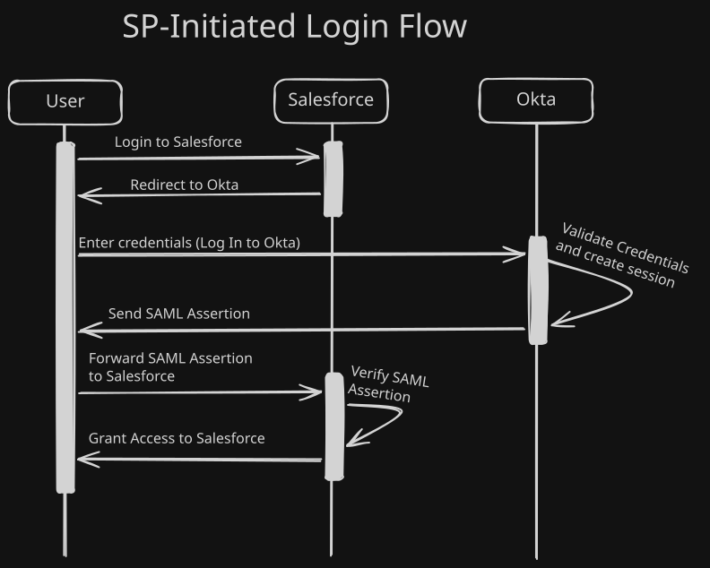

# Salesforce SAML SSO
## Configure Salesforce as a SAML 2.0 Service Provider in Okta. Map the FederationIdentifier so SAML assertions can match Salesforce users. Demonstrate both IdP-initiated and SP-initiated SSO flows. Capture and decode a SAML assertion to verify correctness.
---
### Configuration Steps

**Step 1: Enable SAML in Salesforce**

1. Log in to Salesforce with the administrator account.
2. Navigate to **Setup → Identity → Single Sign-On Settings**.
3. Click **Edit**, check **SAML Enabled**, and click **Save**.
4. Click **New** to create a new SAML SSO configuration.

**Step 2: Map FederationIdentifier in Okta**

1. In Okta, go to the Salesforce app → **General** tab → **SAML Settings → Edit → Next** (Configure SAML section).
2. Under **Attribute Statements**, add/confirm an attribute mapped to `FederationIdentifier`, with the value sourced from `user.email` (or whichever field matches what's stored on the Salesforce user record).
3. Save. This is what lets Salesforce match an incoming assertion to an actual user — without it, authentication will fail even with a perfectly valid, correctly signed assertion.

**Step 3: Populate SAML Settings from Okta**

1. In Okta, open the **SAML Setup Instructions** link (Applications → Salesforce App).
	
2. Use the values from that page to fill in the Salesforce SAML config:
    - Issuer
    - Identity Provider Certificate
    - Identity Provider Login URL
    - Custom Logout URL
    - API Name
    - Entity ID
3. Save the **Login URL** and **Logout URL** for later use.
4. Download the Okta **metadata** file.

**Step 4: Configure Custom Domain in Okta**

1. In Okta, go to the **General** tab of the Salesforce app.
2. Add your **custom domain**.
    - ⚠️ Do **not** include `my.salesforce.com` in this field.

**Step 5: Configure Advanced Sign-On Settings (Okta)**

1. In Okta, go to the **Sign-On** tab of the Salesforce app → **Advanced Sign-On Settings**.
2. Enter the **Login URL** and **Logout URL** saved from Step 3.
3. Check **Enable Single Logout** if SP-initiated single logout is desired.

**Step 6: Configure the Signing Certificate**

1. Copy the `ds:X509` certificate value from Okta's metadata/setup page.
2. Create a `.cert` file formatted as:

```
   -----BEGIN CERTIFICATE-----
   [CERTIFICATE VALUE]
   -----END CERTIFICATE-----
```

3. Upload this `.cert` file into the **Signature Certificate** field (Salesforce SAML config).

**Step 7: Configure Single Logout**

1. Copy the **SingleLogoutService URL** from the Okta metadata file.
2. Paste it into **Identity Provider Single Logout** in the Salesforce SAML setup.
3. Check **Single Logout Enabled** in both Salesforce and Okta.
4. Click **Save** in Salesforce.

**Step 8: Enable SP-Initiated SAML**

1. In Salesforce, set up a **custom domain** (if not already done).
2. In Salesforce **Single Sign-On Settings**, add the custom domain into the **Entity ID** field.
3. In Okta, return to the **General** tab for the Salesforce app, add the same custom domain (without `my.salesforce.com`), and **Save**.
4. Recheck the **Login URL** in Salesforce's Single Sign-On Settings page and **Save**.

**Step 9: Set Okta as the Default Authentication Service**

1. In Salesforce, go to **My Domain**.
2. Under **Authentication Configuration**, check the box next to the Okta instance configured in Single Sign-On Settings.
3. Click **Save**.
---
### Deliverables

**Sequence Diagram of the SAML SP-Initiated flow built**



**Screenshot of IdP-initiated SSO landing on Salesforce**
Okta Dashboard for Stephen Curry:


Salesforce Page for Stephen Curry:


**SAML Tracer screenshot showing decoded assertion with FederationIdentifier (NameID) highlighted**


**Okta Salesforce app configuration screenshot (Sign On tab)**


**Salesforce SSO configuration screenshot**


