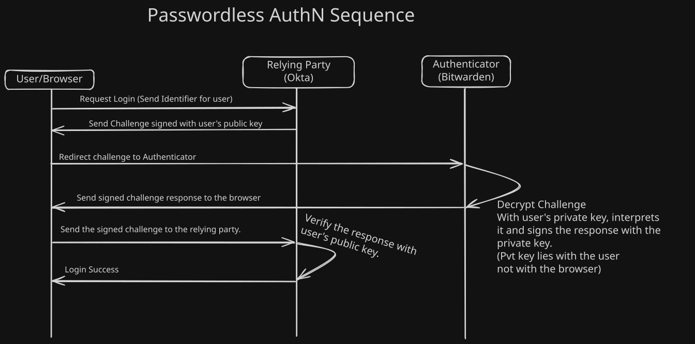

# Passwordless Authentication (FastPass + FIDO2)
### Configuration Steps

**Step 1: Add the Passkey authenticator**

1. Go to **Security → Authenticators → Add authenticator**.
2. Add **Passkey (FIDO2 WebAuthn)**.
3. Check **Show the "Sign in with a passkey" button**.

**Step 2: Confirm FastPass is enabled** _(not in your original notes, verify)_

1. In **Security → Authenticators**, open **Okta Verify** settings.
2. Confirm FastPass is enabled as a verification option. The lab's first success criterion is "FastPass enabled in Authenticator settings".
3. Okta Verify on the test device must be v7.0 or later.

**Step 3: Create the passwordless enrollment policy**

1. Go to **Security → Authenticators → Enrollment** tab and create a new policy.
2. Scope it to the **OKTA_IT_Admins** group.
3. Set **Okta Verify** and **Passkey (FIDO2 WebAuthn)** to required.
4. Set **Email** and **Password** to disabled.
5. Enroll passkey through any authenticator. I used bitwarden.
> [!warning] 
> Do not disable password for the admin group until at least one passwordless authenticator is enrolled and tested, and keep one break-glass admin outside this policy (see Risks below).

**Step 4: Create the "Mamba Passwordless" authentication policy**

1. Go to **Security → Authentication Policies → Add a policy**, named `Mamba Passwordless`.
2. Add a rule with these settings:
    - **User's group membership:** includes `OKTA_IT_Admins`
    - **User must authenticate with:** Any 2 factor types
    - **Possession factor constraints:** Phishing resistant
    - **Allow specific authentication methods:** Okta Verify - FastPass and Passkey (FIDO2 WebAuthn)
3. Save.

**Step 5: Protect the Admin Console**

1. Open the authentication policy used by the **Okta Admin Console** app (the default requires a password).
2. Add a new rule at **priority 1** that allows `OKTA_IT_Admins` to access the console using Okta Verify - FastPass or Passkey (FIDO2 WebAuthn), mirroring the Mamba Passwordless rule.

**Step 6: Attach the policy to an app**

A policy does nothing until an app uses it. Assign Mamba Passwordless to the app(s) you will test with (for example the Okta Dashboard or Salesforce).

**Step 7: Check the Global Session Policy** 

Look at the rule that governs how the Okta session is _established_. If it still lets users start a session with a password, passwordless may not be enforced at the front door. Confirm it allows sessions established by whatever factor satisfied the authentication policy.

**Step 8: Enroll and test**

1. Enroll Kobe Bryant's device (FastPass and/or a passkey\[Bitwarden\]).
2. Log in as Kobe and confirm there is no password field.
3. In **Reports → System Log**, find the authentication event and confirm the factor is `SIGNED_NONCE` (FastPass) or `WEBAUTHN`, never `PASSWORD`.
4. Try a non-enrolled device and confirm it prompts for enrollment instead of falling back to a password.

### Deliverables

**Screen recording or screenshot sequence of passwordless login (no password field)**

**System Log screenshot showing `SIGNED_NONCE` or `WEBAUTHN`**

**Authenticator enrollment screenshot for Kobe Bryant**

**Authentication policy configuration showing password excluded**

**Passwordless AuthN flow Sequence diagram.*

### Key Concepts Recap

#### 1. How passwordless actually works (public-key cryptography)

When you enroll a passkey or FastPass, your device generates a **key pair**. The **private key** stays on the device (often in secure hardware such as a TPM or Secure Enclave) and never leaves. The **public key** is registered with Okta. At login, Okta sends a random challenge (a **nonce**), the device signs it with the private key after you unlock it (biometric or PIN), and Okta verifies the signature with the public key.

_Why this beats passwords:_ there is no shared secret. Nothing typed, nothing stored on the server that an attacker could steal and reuse. A breach of Okta's database yields only public keys, which are useless on their own.

#### 2. Origin binding (the anti-phishing property)

The key pair is tied to the **domain** it was registered for. If a user lands on `mamba-airlines-okta.evil.com`, the browser or device simply won't offer the credential, because the origin doesn't match. The user can't be tricked into handing it over, since there is nothing for them to hand over.

_Contrast with TOTP:_ a 6-digit code is origin-blind. A phishing proxy can ask for it and relay it to the real site within seconds. That is why TOTP and push are not considered phishing-resistant.

#### 3. Signed nonce and replay protection

Each login uses a fresh random nonce. A captured signature is only valid for that one challenge, so replaying it later fails. This is what the `SIGNED_NONCE` value in System Log refers to for FastPass.

#### 4. Passwordless does not mean single-factor

FastPass and passkeys satisfy **two** factors in one gesture: _possession_ (the device holding the private key) and _inherence or knowledge_ (the fingerprint or PIN that unlocks it). That is why the policy says "Any 2 factor types" while still being passwordless. Interview trap: "passwordless means weaker security" is the opposite of the truth.

#### 5. Platform vs roaming authenticators

- **Platform authenticator:** built into the device (Touch ID, Windows Hello). Convenient, tied to that device.
- **Roaming authenticator:** a separate hardware key (YubiKey) that connects over USB or NFC and works across devices.

FIDO2 is the umbrella standard: **WebAuthn** is the browser API, **CTAP2** is how external authenticators talk to the browser. "Passkey" is the user-facing term for a FIDO credential.

#### 6. FastPass vs FIDO2/WebAuthn

Both are phishing-resistant and origin-bound. FastPass is Okta's own device-bound credential delivered through Okta Verify, with device-context signals Okta can use in policy. WebAuthn is an open standard that works with any compliant authenticator. Having both gives admins a fallback if one fails.

#### 7. NIST AAL3, with a caveat worth knowing

The guide maps this lab to AAL3. AAL3 requires phishing-resistant, hardware-bound authentication with a non-exportable key. A **synced** passkey (backed up to a cloud account) is generally treated as AAL2, while a device-bound key or hardware security key is the route to AAL3. Be ready to qualify the claim in an interview rather than just stating "AAL3".

#### 8. Recovery is the weak point

Passwordless is only as strong as the way back in. If a user who loses their device can reset access through email or SMS, an attacker simply targets the recovery path. That is why the enrollment policy disables email and why recovery for admins needs deliberate design.